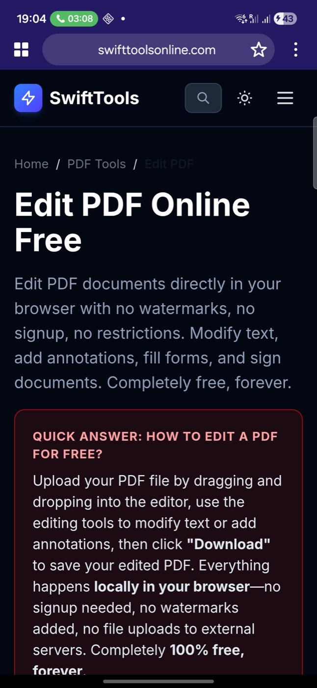
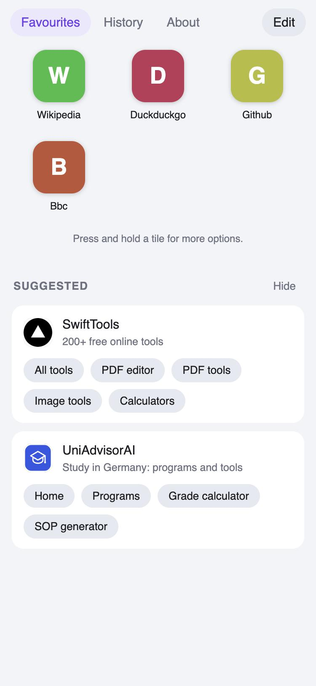
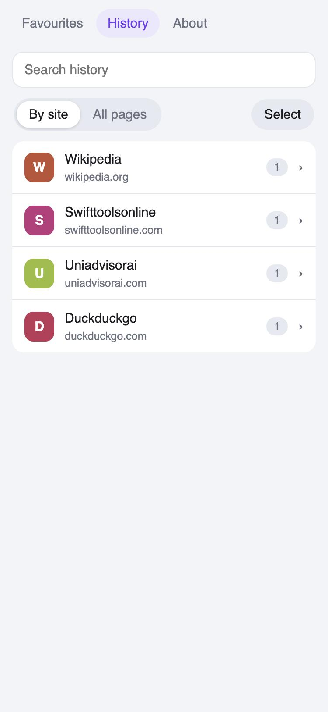
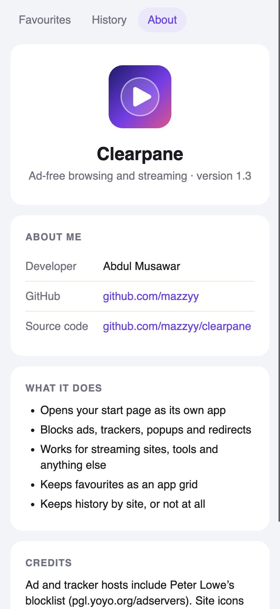

<p align="center"></p>

<h1 align="center">Clearpane</h1>

<p align="center">Ad-free browsing and streaming. Any website, opened as its own app, on Android and macOS.</p>

<p align="center">
  <a href="https://github.com/mazzyy/clearpane/releases/latest/download/Clearpane-android.apk"><b>Download for Android (.apk)</b></a>
  &nbsp;·&nbsp;
  <a href="https://github.com/mazzyy/clearpane/releases/latest/download/Clearpane-mac.dmg"><b>Download for Mac (.dmg)</b></a>
</p>

<p align="center">
  
  
  
  
</p>

## What it does

- **Start page**: the address you set in Settings opens every time the app starts.
- **Ad and tracker blocking**: about 80,000 known ad, tracker and malware hosts are blocked
  on Android (about 3,700 on Mac), and common ad containers and floating banners are hidden.
- **Popup and redirect blocking**: no second windows, and a "stay on this site" lock that
  stops a page sending you somewhere else. Search results still open normally.
- **Favourites as apps**: saved pages appear as a grid of tiles with each site's own icon.
  On Android, press and hold a tile to put it on your home screen as its own icon.
  A small Suggested section sits underneath and can be hidden.
- **Your choice of start**: open on your favourites, where you left off, or a start page.
- **Background audio** (Android): sound keeps playing with the screen off.
- **Uploads and downloads** (Android): including files a page builds itself, such as an
  edited PDF.
- **History your way**: grouped by site or as a flat list, with search and multi-select
  delete. Save every page, only website names, or nothing.
- **Address or search**: tap the site name in the toolbar to type an address, or words to
  search with DuckDuckGo.
- **YouTube ad skipper** (optional, best effort): presses Skip, jumps unskippable ads to
  their end, hides promoted slots. This is against YouTube's terms of service and breaks
  whenever YouTube changes its page.

## Install

### Android

1. Download **Clearpane-android.apk** from the link above, on your phone.
2. Open the downloaded file. Android will ask to allow installs from your browser or
   file manager: allow it, then tap **Install**.
3. On Samsung phones, **Auto Blocker** stops installs from outside the Play Store. Turn it
   off under Settings → Security and privacy → Auto Blocker, install, then turn it back on.

Needs Android 7.0 or newer.

### Mac

1. Download **Clearpane-mac.dmg** from the link above and open it.
2. Drag **Clearpane** onto the **Applications** folder.
3. The first time, macOS will refuse to open it because the app is not signed by a
   registered Apple developer. Open **System Settings → Privacy & Security**, scroll to the
   message about Clearpane, and click **Open Anyway**. You only do this once.

Needs macOS 13 or newer. Works on Apple silicon and Intel Macs.

## Using it

| To do this | Android | Mac |
|---|---|---|
| Set your start page | ⋮ → Settings | ⌘, |
| Go to an address or search | Tap the site name in the toolbar | Type in the address bar |
| Save the current page | Star in the toolbar | Star in the toolbar, or ⌘D |
| Open Favourites | Grid button in the toolbar | Grid button in the toolbar |
| Put a site on the home screen | Press and hold its tile → Add to home screen | not available |
| Open History | ⋮ → History | History → Show History |
| Delete history | History → Select → Select all → Delete | same |
| Hide the Suggested section | Hide, next to Suggested | same |

If a site's sign-in sends you through another domain and gets stuck, turn off
**Stay on this site** in Settings.

## Build it yourself

| Folder | What it is |
|---|---|
| `mac/` | macOS app: one Swift file (`main.swift`), `build.sh` and `package.sh` |
| `android/` | Android app: a Gradle project with one Java activity |
| `shared/` | Files both apps bundle: blocklists, the built-in pages, page scripts, icon generator |

The Favourites, History and About screens are one HTML file, `shared/app-pages.html`,
used by both apps. Its script starts with an `AUTHOR` block (the About tab) and a
`FEATURED` list (the Suggested section).

**Mac** needs the Xcode command line tools (`xcode-select --install`):

```bash
cd mac && ./package.sh
```

This builds `mac/Clearpane.app` and `dist/Clearpane-mac.dmg`.

**Android** needs JDK 17 and the Android SDK (platform 34, build-tools 34). Open
`android/` in Android Studio and press Run, or:

```bash
cd android && ./gradlew assembleDebug
```

The APK is written to `android/app/build/outputs/apk/debug/app-debug.apk`.

After changing anything in `shared/`, copy it into the Android assets before building:

```bash
cp shared/blocklist*.txt shared/*.js shared/app-pages.html android/app/src/main/assets/
```

## Notes

- **Blocklists**: `shared/blocklist.txt` is maintained by hand. `shared/blocklist-extra.txt`
  is Peter Lowe's ad and tracking server list from <https://pgl.yoyo.org/adservers/>; it is
  his work, and that site has its licence terms. `shared/blocklist-large.txt` is the
  StevenBlack unified hosts list from <https://github.com/StevenBlack/hosts> (MIT licence),
  used by the Android app. Blocking is by host name plus general page rules in
  `shared/adblock.js`, so ads served from the same host as the content can get through.
- **Site icons** in Favourites are fetched from each site and belong to their owners.
- **App IDs**: the Android application ID is `io.github.mazzyy.clearpane`. Versions before
  1.3 used `com.local.webshell`, so 1.3 installs as a new app; uninstall the old one. The
  macOS bundle ID is still `com.local.webshell`.
- **F-Droid**: the app builds from source with no proprietary dependencies, and store
  metadata lives in `fastlane/metadata/android`. It has not been submitted to F-Droid yet.
- **Signing**: the APK is a debug-signed build and the Mac app is ad-hoc signed, which is
  why both need the extra install step above.
- **Licence**: GPL-3.0. See [LICENSE](LICENSE).

Made by [Abdul Musawar](https://github.com/mazzyy).
